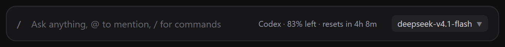

# Provider Quota — live quota in the Hermes desktop composer

A tiny read-only chip beside the model picker that answers one question: **how much of my current
provider's allowance is left?**



It follows whichever provider the focused chat is actually using, refreshes once a minute, and
shows reset countdowns on hover.

```
Codex · 83% left · resets in 4h 8m        ← hover: Session 83% · Weekly 90% · Plus plan
OpenRouter · $12.34 left                  ← hover: API-key budget, today/week/month spend
OpenCode Go · 99% left · resets in 8h 12m ← hover: rolling / weekly / monthly
```

No model calls, no telemetry, no new tools in the agent's schema, no edits to Hermes itself.

## Install

```bash
hermes plugins install Simao-Lopes/hermes-provider-quota --enable
```

Then **restart Hermes once.** The desktop half hot-loads, but the plugin's backend route is mounted
when the local `hermes serve` backend starts.

Requirements: Hermes Agent with the desktop app, and the `hermes-agent` runtime (it ships
`fastapi`/`httpx` already). macOS, Linux and Windows.

Verify:

```bash
hermes plugins list --plain --no-bundled | grep provider-quota   # enabled
```

Open a chat; the chip appears immediately left of the model picker. Hover it for the full
breakdown, click to refresh.

Uninstall: `hermes plugins disable provider-quota` (and delete
`$HERMES_HOME/plugins/provider-quota`).

## What it can read

| Provider in Hermes | Source | Shown |
|---|---|---|
| `openai-codex` (ChatGPT plan) | Codex usage API | Session + weekly remaining, reset times, banked resets, credit balance |
| `anthropic` (Claude subscription, OAuth) | Anthropic OAuth usage API | Current session, current week, per-model weeks, extra usage |
| `openrouter` | OpenRouter credits + key APIs | Credit balance, API-key budget, today / week / month spend |
| `nous` | Nous Portal account | Subscription credits, top-up credits, total usable, renewal date |
| `opencode-go` | `opencode.ai/zen/go/v1/usage` | Rolling, weekly and monthly allowance |

Everything else reads **`<Provider> · quota unavailable`** on purpose. DeepSeek, Gemini API keys,
Groq, Mistral, local models and most API-key providers publish no per-key remaining balance, and a
number invented from token usage would be a lie. (For subscription surfaces, `/usage` in the CLI
and desktop chat remains available.)

## Privacy and safety

- **Read-only.** It calls the provider's own account/usage endpoint. It never sends a completion
  request, never writes to the provider, and never touches your session history.
- **Credentials stay in the backend.** The router resolves the focused live session's agent
  in-process and reuses that agent's credential and base URL. Credentials are never returned to the
  renderer, logged, or persisted; the cache key is a SHA-256 digest, not the key.
- **One request per credential per minute.** Cached for 60 s, keyed by provider + base URL + a
  digest of the credential, so switching chats does not multiply provider calls. The chip polls at
  most once a minute and revalidates when the window regains focus.
- **Strict destination pinning.** OpenCode Go requests only go to `https://opencode.ai/zen/go/v1/usage`,
  and only when the session's own base URL is an `https://opencode.ai/...` endpoint; anything else
  is refused locally without sending the key.
- **Scoped to your profile.** The route refuses a session that belongs to another profile (409) and
  a session that is no longer live (404). Requests travel over the local backend's normal token-auth
  path, like every other `/api/plugins` route.
- **Honest failure.** A 4xx, a timeout, a malformed payload, or a missing window renders
  "unavailable". It never renders `0% used` for data it could not read.

## Limits

- **Desktop only.** The chip is a desktop-app plugin. The backend route also exists in
  `hermes dashboard`, but there is no chip to render it.
- **Compute-host sessions** (process-isolated agents) show unavailable: the credential lives on the
  other host and this plugin will not substitute a different account's quota.
- **Remote gateways** need the plugin installed on the gateway that serves the chat.
- Provider APIs change without notice. If a source disappears, the chip says unavailable rather
  than guessing — the fix belongs in `dashboard/plugin_api.py`.

## How it is built

One Hermes plugin, three halves:

| Path | Role |
|---|---|
| `plugin.yaml` + `__init__.py` | Native plugin manifest and a no-op `register(ctx)` — no tools, hooks or middleware |
| `dashboard/plugin_api.py` | Read-only FastAPI router at `/api/plugins/provider-quota/quota`, mounted by the local backend |
| `desktop/plugin.js` | The chip, contributed to `COMPOSER_AREAS.actions` with `@hermes/plugin-sdk` |

Hermes copies `desktop/plugin.js` into `$HERMES_HOME/desktop-plugins/provider-quota/` when the
package is present, then hot-reloads it like any disk plugin.

## Development

```bash
git clone https://github.com/Simao-Lopes/hermes-provider-quota
cd hermes-provider-quota
npm install                 # test-only deps (React, React Query, jsdom)

npm test                    # desktop half: real component in jsdom, offline
python tests/test_backend.py   # backend half: needs the Hermes runtime on PYTHONPATH
hermes plugins validate .   # manifest, declarations, capability probe
```

The non-negotiable invariants: never fabricate quota, never send inference, keep credentials in the
backend, and pin the destination before sending a key. The provider-addition recipe and the test
conventions live in the repo's agent guide (`AGENTS.md`).

## License

MIT — see [LICENSE](LICENSE).
